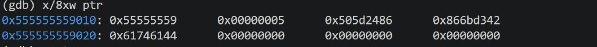
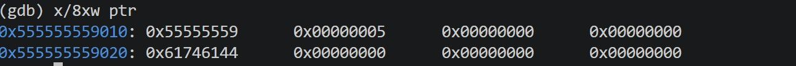

# Lab 05: Use-After-Free (UAF)

## 1. Vulnerability Code (漏洞源码)
The vulnerability occurs when a pointer is used after its associated memory has been freed. The program frees `ptr` but fails to set it to `NULL`. A subsequent `malloc` call by an attacker reclaims the exact same memory chunk, allowing the attacker to overwrite the data that the dangling pointer `ptr` still references.

*(See `vuln.c` for full code)*

## 2. Compilation Environment (编译环境)
```bash
gcc vuln.c -o vuln -g
```
## 3. Execution & Analysis (执行与分析)
### 3.1 Execution Analysis (执行分析)
When running the program, you will observe:

ptr initially holds the "Original Secret Data".

After free(ptr), the memory is returned to the heap allocator.

hacker_ptr is allocated with the exact same size (32 bytes), which glibc's tcache or fastbin will immediately reallocate from the recently freed chunk.

**GDB Memory Inspection:**



The dangling ptr now prints "HACKED! Malicious Data", proving successful memory hijacking.

### 3.2 The Danger of UAF (UAF的危害)
In modern exploitation, UAF is a powerful primitive. If a virtual function pointer (vtable) is stored in the freed chunk, the attacker can overwrite it with a fake pointer, leading to direct RIP control and Remote Code Execution (RCE).

*(See exploit.py for the automated PoC script).*

## 4. Remediation (修复建议)
Always set pointers to NULL immediately after freeing them to prevent dangling references:
```c
free(ptr);
ptr = NULL;
```
*Created by Admin| Date: 2026.11*