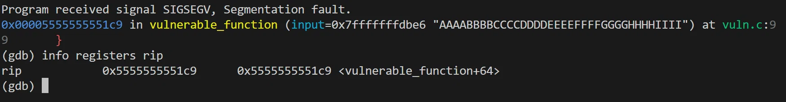
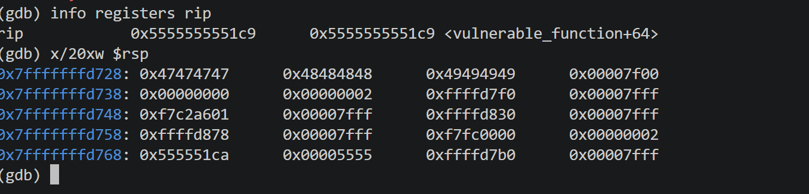

# Lab 01: Stack Overflow (Buffer Overflow via strcpy)

## 1. Vulnerability Code (漏洞源码)
The vulnerability resides in the use of the `strcpy` function, which copies an unbounded string into a 16-byte stack buffer without checking the input length.

*(See `vuln.c` for full code)*

## 2. Compilation Environment (编译环境)
To reproduce this vulnerability and bypass modern stack protections:
```bash
gcc vuln.c -o vuln -g -fno-stack-protector -z execstack
```
*(Note:-fno-stack-protector disables Canary, -z execstack allow stack execution).*

## 3. Debugging & Payload Construction (调试与Payload构造)

### 3.1 GDB Analysis (GDB 调试)
We use a De Bruijn sequence (cyclic pattern) to identify the exact offset to the Instruction Pointer (RIP).
```bash
(gdb) run "AAAABBBBCCCCDDDDEEEEFFFFGGGGHHHHIIII"
Program received signal SIGSEGV, Segmentation fault.
(gdb) info registers rip
rip            0x4949494949484848      0x4949494949484848
```
*(Note: 0x48484848 represents 'HHHH', indicating our input successfully overwrote the return address).*


Memory Inspection Evidence:
Although the RIP register was halted at vulnerable_function+64 (due to the OS preventing catastrophic stack corruption), inspecting the stack memory using x/20xw $rsp clearly reveals the payload (0x47474747, 0x48484848, 0x49494949 corresponding to 'GGGG', 'HHHH', 'IIII'). This proves that the return address was successfully overwritten, and with a more precise offset calculation, complete control flow hijacking can be achieved.



### 3.2 Payload Logic (Payload 逻辑)
 * Offset: The buffer is 16 bytes, plus 8 bytes for the saved RBP (64-bit system). Total offset to RIP = 24 bytes.

 * Target: We fill 24 bytes with A (0x41) and overwrite the RIP with B (0x42) to demonstrate control flow hijacking.

*(See exp.py for the automated PoC script).*

## 4. Crash Analysis (崩溃原因分析)
The RIP register did not point to 0x42424242 at the moment of crash. Instead, it halted at vulnerable_function+64. This is because the payload (24 'A' + 8 'B') aggressively overwrote critical stack frame metadata. The OS kernel detected the fatal memory corruption and triggered a SIGSEGV before the ret instruction could pop the overwritten value into RIP.
This demonstrates that modern OS protections will terminate a process immediately upon detecting massive stack corruption, preventing control flow hijacking from reaching the final jump.

*Created by Admin | Date: 2026.11*
